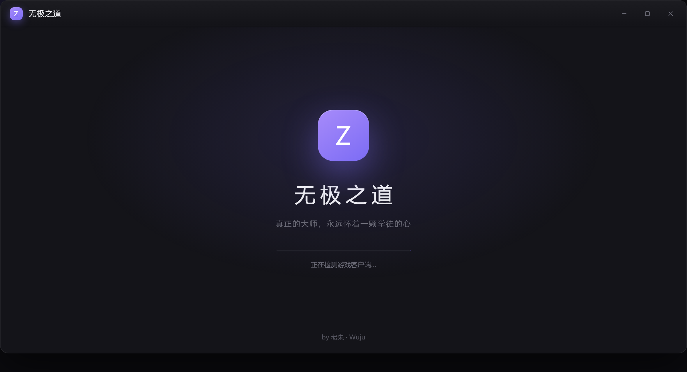
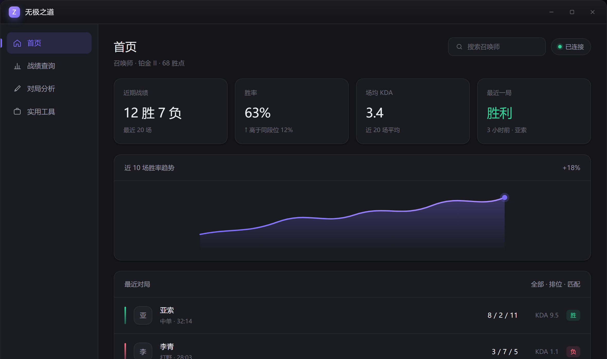
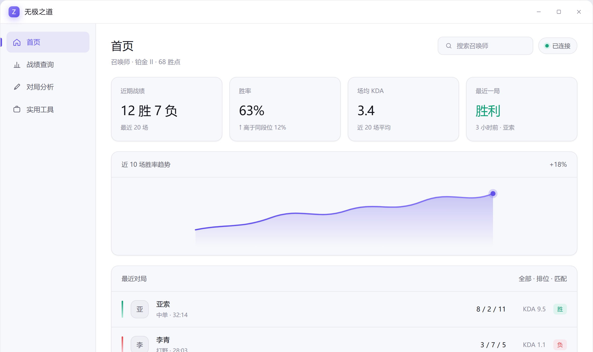
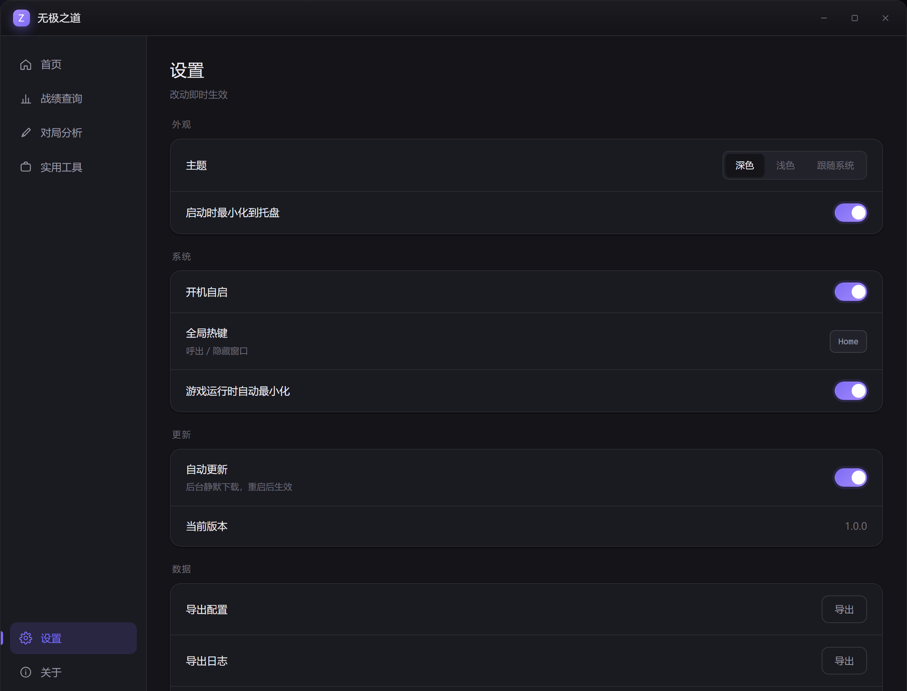

# AI 无极之道

**真正的大师，永远怀着一颗学徒的心**

英雄联盟客户端助手工具

**中文名：AI 无极之道 ｜ English name: Wuju ｜ 仓库标识符：`wuju`**

---

## 📖 这是什么

一个基于 Riot 官方 **LCU 接口**开发的英雄联盟客户端助手。

> ⚠️ 本软件**不侵入游戏、不修改对局数据**，仅读取客户端公开接口。
> **非官方产品**，与 Riot Games、腾讯无关，使用风险自负。

---

## ✨ 界面预览

| 主界面 · 深色 | 主界面 · 浅色 |
|:---:|:---:|
|  |  |

| 设置页 | 启动页 |
|:---:|:---:|
|  |  |

> 界面提供**多套主题**，可一键切换（上图为「现代柔和」主题的深色 / 浅色两种形态）。

---

## 🚀 下载安装

**当前状态：开发准备阶段，尚未发布。**

发布后会提供两种形态（都在 GitHub Releases 下载）：

- **安装版**（`.exe`）—— 常规安装，有开始菜单快捷方式
- **便携版**（`.7z`）—— 解压即用，**零系统残留**（推荐）

---

## ❓ 常见问题

<b>会被封号吗？</b>

本软件**只读取官方客户端接口，不侵入游戏、不修改对局数据**。但任何第三方工具都存在风险，**请自行评估后再决定是否使用**。

<b>支持哪些区服？</b>

**只做国服（腾讯服）**。外服不在支持范围内。

<b>需要管理员权限吗？</b>

**不需要**。安装与运行都不要求管理员权限。

<b>怎么彻底退出？</b>

点窗口右上角的 × **只是隐藏到托盘**。要真正退出，请**右键点击托盘图标 → 退出**。

<b>会上传我的数据吗？</b>

**不会**。所有数据都存在你自己电脑上，软件不做任何用户数据收集。

---

## 📚 界面演示

- **[界面演示](docs/ui-preview.html)** —— 可交互的界面演示，浏览器直接打开即可查看

---

## ⚠️ 免责声明

> **非官方产品**，与 Riot Games、腾讯及其关联公司**没有任何关系**。

本软件是基于 Riot 官方 LCU 接口开发的第三方工具，**不侵入游戏、不修改游戏数据**。

使用本软件可能带来账号风险，**开发者不对由此产生的任何后果（包括账号封禁、数据丢失）负责**。

请在使用前充分理解风险，自行承担相应责任。也请在游戏环境中保持公平竞技。

---

## 👤 作者

**老朱（laozhu）**

## 📄 许可证

[MIT](LICENSE)
